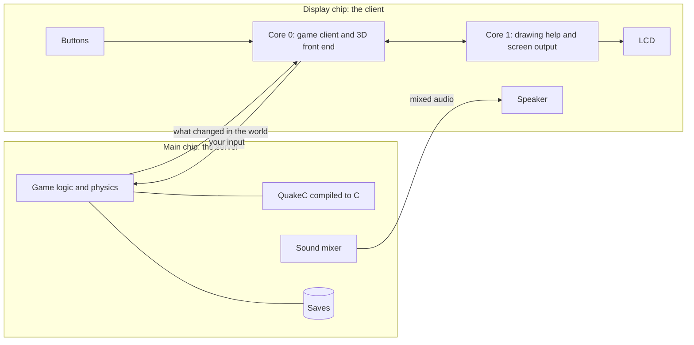
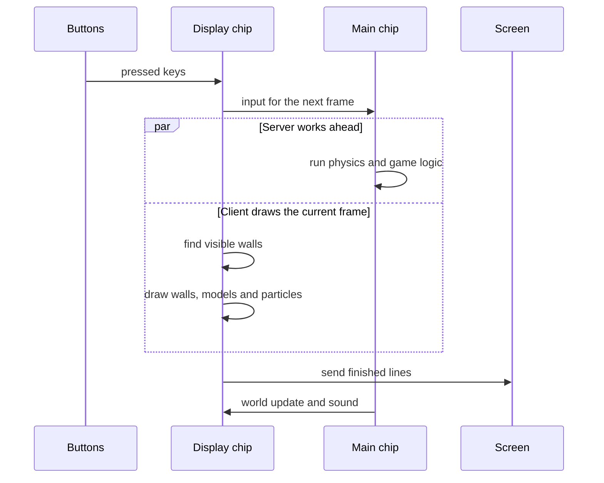
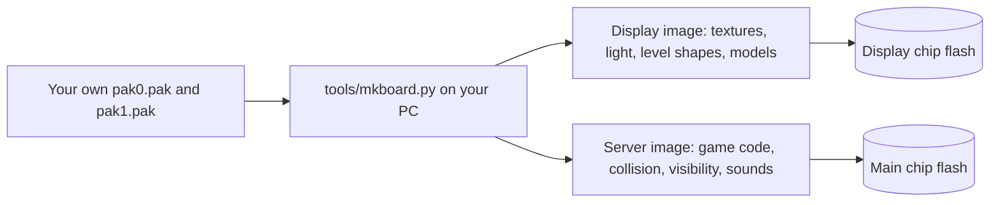
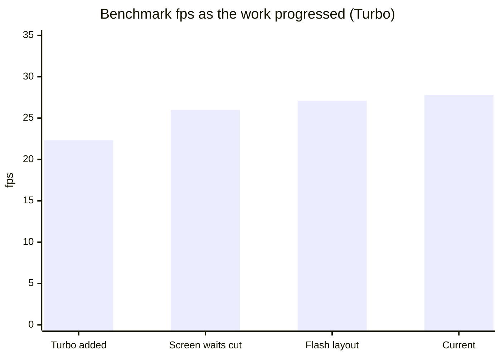
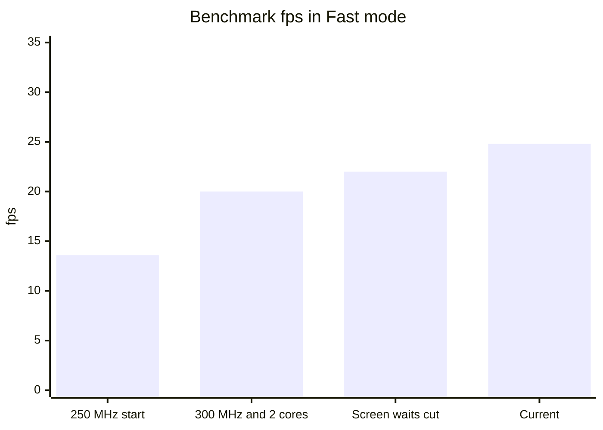

# QuakeOG

id Software's Quake, running on two RP2040 microcontrollers that have no floating point unit and no external RAM.

The board is the FREE-WILi OG, a handheld with two RP2040s. One chip runs Quake's **server** (the game world) and the other runs the **client** (the picture, the menus and the buttons). They talk over a wire the same way Quake talks over a network.

<!-- Photo: replace this line with a picture of the board running E1M1, for example  -->

New here? [docs/showcase.md](docs/showcase.md) explains why this is hard and how it works.

## At a glance

| | |
| --- | --- |
| Chips | Two RP2040 (Cortex-M0+, 2 cores each), 264 KB RAM and 16 MB flash per chip |
| Screen | 320x240 LCD. Quake draws 320x200, of which 320x152 is the 3D view |
| Sound | Quake's own mixer, played through the board's speaker |
| Controls | Five buttons |
| Saves | Save and load work, stored in flash |
| Content | Episode 1 on the board |
| Benchmark | 24.8 fps (Fast) and 27.8 fps (Turbo), `timedemo demo3` |

## How it works



The wire between the chips is a UART at 12.5 Mbaud.

### One frame



### Where the data lives

Quake normally loads a level into RAM. Here there is too little RAM, so a PC tool prepares each level in advance and the chips read it straight from flash.



## Speed

All figures were measured on the board with Quake's `timedemo demo3` benchmark.





### Picture modes

Choose them in **Options, Render**.

| Mode | What you get | Benchmark |
| --- | --- | --- |
| Exact | The same pixels id's own renderer draws | 12.8 fps |
| Fast (default) | Full detail with small shortcuts, about 3.4% of pixels differ in PC tests | 24.8 fps |
| Turbo | 3D view drawn at half width, visibly blockier | 27.8 fps |

### Compared with other ports

| Port | Chip | Floating point unit | Reported speed |
| --- | --- | --- | --- |
| **QuakeOG** | 2x RP2040 | no | 24.8 fps (Fast), 27.8 fps (Turbo, half width) |
| [MG24Quake](https://github.com/next-hack/MG24Quake) | EFR32MG24, Cortex-M33 | yes | about 29 fps |
| [Quake-ESP32S3](https://github.com/recrof/Quake-ESP32S3) | ESP32-S3 with 8 MB PSRAM | yes | about 42 fps |

QuakeOG is **not** the fastest. What sets it apart is the hardware. It has no floating point unit and no external RAM, and the game is split across two chips. A search in November 2026 found no other Quake port on the RP2040, which does not prove there is none.

The numbers are not perfectly like for like. Each project chooses its own picture shortcuts. QuakeOG's Fast picture stays closer to the original than MG24Quake's method does on our test frames.

## Limits

- Only one episode fits on the board at a time. The whole game's data is larger than both flash chips together.
- Episode 1 is what runs on the board. Images for episodes 2 and 3 can be built but have not been tried on the board.
- No multiplayer, CD music or keyboard console.
- In rare views the small depth buffer cannot cope and the game stops with an error.
- 35 fps was the goal and was not reached.

## Overclocking warning

The speeds above use **300 MHz at 1.25 V with flash at 150 MHz**. That is above the RP2040's rating, and above the flash chip's 133 MHz rating. The game checks the flash at start and falls back if reads fail, but you run it at your own risk.

To stay within the flash rating add `-DQOG_FLASH_MAX_KHZ=133000`. To keep the stock clock use `-DQOG_SYS_KHZ=0`.

## Game data

Quake's game data belongs to id Software. **None of it is in this repository, and nothing made from it should ever be committed.** `data/`, `*.pak` and board images are git-ignored. You supply your own copy and the tools convert it on your PC.

Use the registered game (Steam or GOG). Put `id1\pak0.pak` and `id1\pak1.pak` in `data\id1\`. The shareware licence does not allow modified or derived copies of its data, and board images are derived. See [docs/game-data.md](docs/game-data.md).

## Build it

You need these tools.
- the toolchain of the Raspberry Pi Pico VS Code extension (`~/.pico-sdk` with SDK 2.3.0, GCC `15_2_Rel1`, ninja 1.13.2, picotool 2.3.0).
- CMake 3.21 or newer and Python 3.
- Visual Studio Build Tools 2022, for the PC version used to prepare level data.

```bash
git clone https://github.com/freewili/wiliOGbsp third_party/wiliOGbsp
python -m pip install pyserial
```

The board support package is a separate project with its own licence. It is cloned next to this code and is not part of this repository.

If your board has never had the BSP's display bootloader, install it once (`fw bootloader`, see the BSP's README).

### Flash the game

Run these from the repo root. Put only one chip in BOOTSEL at a time. **Read [docs/lessons.md](docs/lessons.md) before your first flash.**

1. Build the PC version and record the asset lists ([docs/game-data.md](docs/game-data.md)). Then make both data images.

   ```powershell
   python tools\mkboard.py --pak data\id1\pak0.pak --pak data\id1\pak1.pak --manifests build-pc-dev\manifests `
       --maps start e1m1 e1m2 e1m3 e1m4 e1m5 e1m6 e1m7 e1m8 --exe build-pc-dev\Release\quakeog_pc.exe `
       --stub-maps --main --display-no-sounds --display-no-progs -o build-board\qb
   ```

2. Build the game. Give every option each time, because the build folder remembers old values.

   ```bash
   cmake --preset target -DQOG_SPLIT=ON -DQOG_AOT=ON -DQOG_AOT_PAK=<full path to pak0.pak> -DQOG_SPLIT_MAIN_EMBED=quake_display -DQOG_SOUND=ON -DQOG_CL_HUNK_KB=75 -DQOG_CL_STACK_KB=32 -DQOG_SV_HUNK_KB=174 -DQOG_SV_STACK_KB=21 -DQOG_SYS_KHZ=300000 -DQOG_SYS_MV=1250 -DQOG_FLASH_FAST=ON -DQOG_FLASH_MAX_KHZ=150000 -DQOG_FAT_FORMAT_IF_MISSING=ON -DQOG_BOARD_TURBO=ON -DQOG_BOARD_HOTTEXT=ON
   cmake --build build --target quake_main
   ```

   `QOG_FAT_FORMAT_IF_MISSING` formats the save area on the main chip if it finds none.

3. Write the display's data with `python third_party/wiliOGbsp/tools/fw.py bootsel --cpu display`, then copy `build-board\qb.uf2` to the RPI-RP2 drive.
4. Flash the game with `python third_party/wiliOGbsp/tools/fw.py flash quake --uf2 build/apps/quake/quake_main.uf2`
5. Write the server's data with `python third_party/wiliOGbsp/tools/fw.py flash quake --uf2 build-board\qb_main.uf2`

Never copy a display *application* by hand ([lessons](docs/lessons.md), L4). Both chips print timing lines over USB serial.

## Controls

| In the game | Button |
| --- | --- |
| Fire (tap for one shot, hold to keep firing) | Gray |
| Forward | Yellow |
| Turn left / right | Green / Blue |
| Next / previous weapon | Red tapped / Red + gray |
| Back | Red + yellow |
| Jump | Red + green |
| Swim down | Red + blue |
| Menu | Green + blue |
| Power off | Hold red alone for 6 s |

| In menus | Button |
| --- | --- |
| Up / down | Yellow / Blue |
| Left / right | Green / Red |
| Select, yes | Gray |
| Back, no | Green + blue |

## Repository layout

```
engine/      id's WinQuake source, changed behind QOG_ build flags (GPL, see engine/COPYING)
port/        the layer Quake needs from a system: rp2040/, pc/, common/
platform/    board drivers for video, input and data
apps/        quake (the game) and smaller test apps
pc/          Windows build, for development and picture tests
tools/       level data preparation, tests, speed model
docs/        documentation, see docs/README.md
```

## Documentation

Start with [docs/README.md](docs/README.md).

## Licences

- This code is under the GNU GPL, version 2 or later ([LICENSE](LICENSE)). `engine/` comes from id Software's GPL release of Quake ([engine/PROVENANCE.md](engine/PROVENANCE.md)).
- Parts under other terms are listed in [THIRD_PARTY_NOTICES.md](THIRD_PARTY_NOTICES.md).
- The board support package is not included. It is under the FreeWili Hardware License, which allows use on FreeWili hardware only and is not open source.
- **Source code only.** Do not share built firmware (`.uf2`, `.elf`, `.bin`). It combines GPL code with the board support package, whose hardware restriction the GPL does not allow, and board images also contain Quake game data.
- Quake is a trademark of its owner. This project is not affiliated with or endorsed by id Software, Bethesda or FreeWili.
