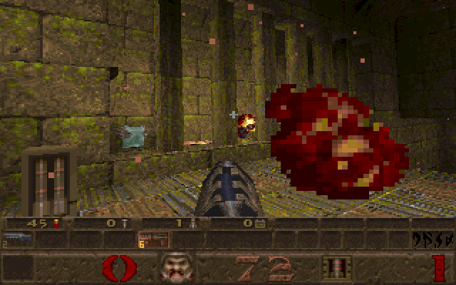
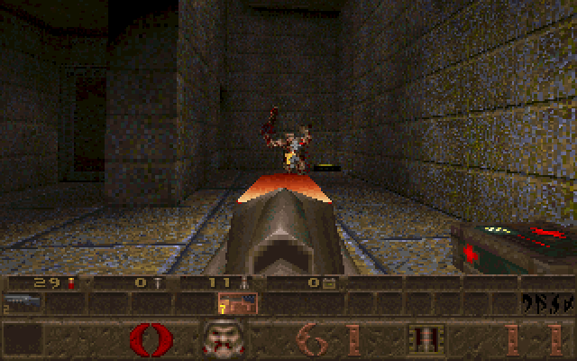
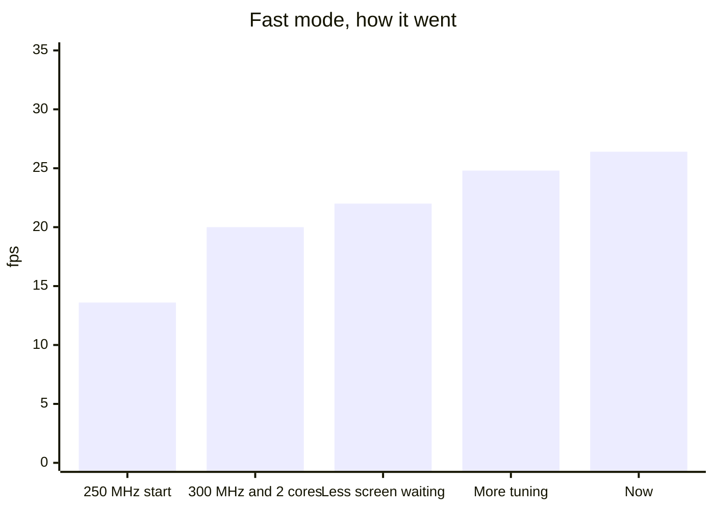
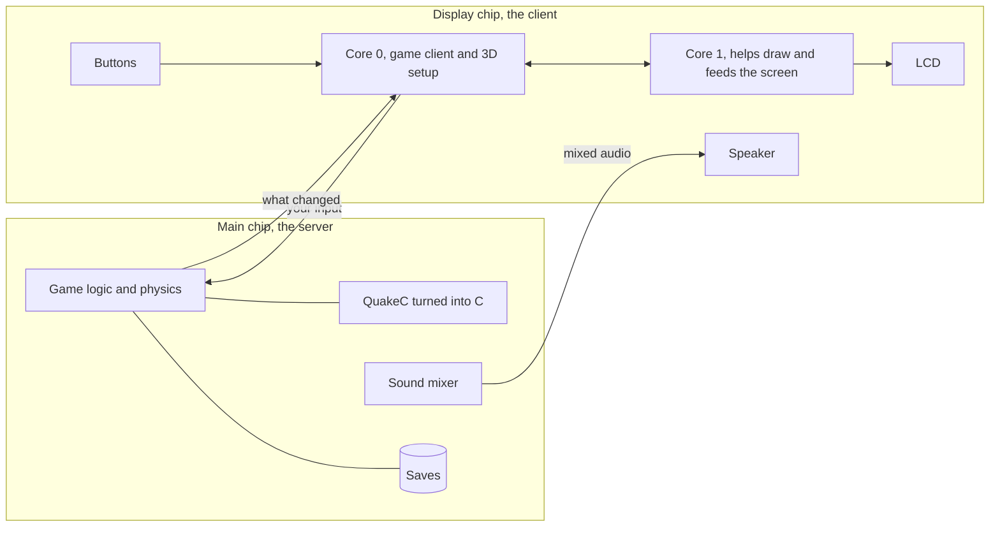
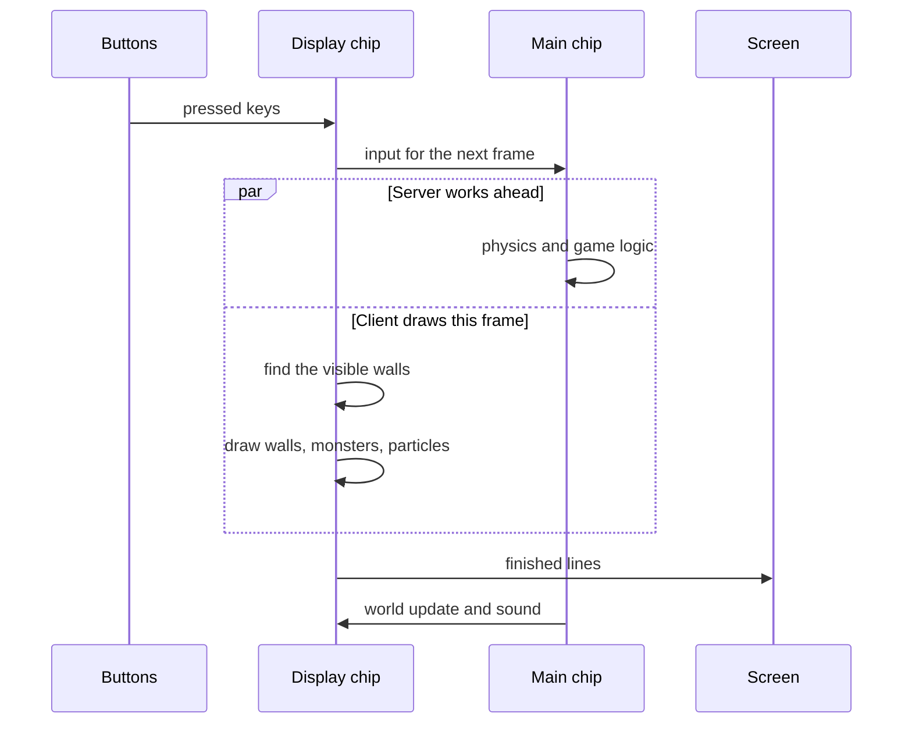
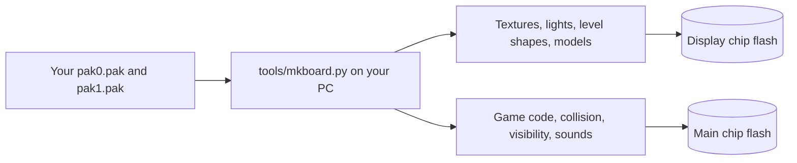

# QuakeOG

**I got Quake running on two RP2040s.** No floating point unit, no external RAM, just two tiny chips talking to each other.

| | |
| --- | --- |
|  |  |
|  |  |
|  |  |

<sub>These are from my PC build of the same code in Exact mode, brightened a bit. They are not photos of the board. Quake and its art belong to id Software.</sub>

## So what is this

The board is the FREE-WILi OG, a handheld with two RP2040s in it. One chip is not enough for Quake, so I split it the way Quake already splits itself for multiplayer. One chip is the **server** and runs the world. The other is the **client** and draws it. The wire between them acts like the network.

It plays with sound, it saves and loads, it has its own menus for five buttons, and episode 1 is on it.

If you want the long story, read [docs/showcase.md](docs/showcase.md).

## The numbers

The goal I measure myself against is [MG24Quake](https://github.com/next-hack/MG24Quake). My numbers are from the actual board running `timedemo demo3`, and the runs are listed in [docs/fps-board.md](docs/fps-board.md).

| | fps | Time per frame |
| --- | --- | --- |
| MG24Quake, their number | 29.2 | 34.2 ms |
| **QuakeOG Fast** (default) | **26.4** | 37.9 ms |
| QuakeOG Exact, same pixels as the original renderer | 12.8 | 78.3 ms |

**I am still behind, by about 3.7 ms a frame.**

Both draw the full 320x200 screen with a 320x152 3D view and the status bar, with sound on, and count all frames over total time. The hardware is not equal. I use two chips overclocked to 300 MHz and they use one chip at a bit over 136 MHz.

Fast takes small shortcuts. On my test frames it changes 3.4% of the pixels on average and 10.5% in the worst frame. MG24Quake is not identical to the original either, but I have not measured by how much. My Fast number is one run and the Exact number is from an older build.

There is also a **Turbo** mode at 31.6 fps. It draws the 3D view at half width with a flat gun picture, so it is a lighter job and I do not compare it with anyone.

You switch between them in **Options, Render**.



I wanted 35 fps. I did not get there.

### Next to other ports

| Port | Chip | Has an FPU | Speed they report |
| --- | --- | --- | --- |
| **QuakeOG** | 2x RP2040 | no | 26.4 fps |
| [MG24Quake](https://github.com/next-hack/MG24Quake) | EFR32MG24 (Cortex-M33) | yes | 29.2 fps |
| [Quake-ESP32S3](https://github.com/recrof/Quake-ESP32S3) | ESP32-S3 with 8 MB PSRAM | yes | about 42 fps |

So no, it is not the fastest. What I like about it is the hardware it runs on. When I searched in November 2026 I did not find another Quake port on the RP2040, but that does not mean there is none.

Everyone picks their own picture shortcuts, so no two of these numbers are a perfect comparison. The missing FPU and the small 16 KB flash cache hurt a lot. I have not proven this is the most the RP2040 can do.

## How it works



The two chips talk over UART at 12.5 Mbaud.

While one chip draws a frame, the other is already working out the next one.



There is not enough RAM to load a level the normal way. So a tool on your PC prepares it first and the chips read it straight from flash.



## What does not work

- Only one episode fits at a time. The full game is bigger than both flash chips together.
- Only episode 1 has been run on the board. Episodes 2 and 3 build but I have not tried them on it.
- No multiplayer, no CD music, no keyboard console.
- In a few rare views the small depth buffer runs out of room. For that one frame monsters and particles can show through walls.

## Before you flash, read this

I run it at **300 MHz and 1.25 V with the flash at 150 MHz**. That is over what the RP2040 is rated for and over the flash chip's 133 MHz. The game checks the flash when it starts and backs off if reads fail, but it is your board and your risk.

Add `-DQOG_FLASH_MAX_KHZ=133000` to keep the flash in spec, or `-DQOG_SYS_KHZ=0` to keep the stock clock.

## Bring your own game

I do not include any Quake data and you should never commit any. `data/`, `*.pak` and board images are ignored by git.

Use the full game from Steam or GOG and put `id1\pak0.pak` and `id1\pak1.pak` in `data\id1\`. The shareware licence does not allow modified copies and the board images count as that. More in [docs/game-data.md](docs/game-data.md).

## Build it

You need these.

- The toolchain from the Raspberry Pi Pico VS Code extension (SDK 2.3.0, GCC `15_2_Rel1`, ninja 1.13.2, picotool 2.3.0)
- CMake 3.21 or newer and Python 3
- Visual Studio Build Tools 2022 for the PC build. That build is Windows only, and you need it to make the data images

```bash
git clone https://github.com/freewili/wiliOGbsp third_party/wiliOGbsp
python -m pip install pyserial
```

If your board never had the BSP's display bootloader, install it once with `fw bootloader` (see their README).

### Flash it

Run these from the repo root and put only one chip in BOOTSEL at a time. **Please read [docs/lessons.md](docs/lessons.md) first.** I learned most of it the hard way.

1. Build the PC version and record the asset lists ([docs/game-data.md](docs/game-data.md)), then make both data images.

   ```powershell
   python tools\mkboard.py --pak data\id1\pak0.pak --pak data\id1\pak1.pak --manifests build-pc-dev\manifests `
       --maps start e1m1 e1m2 e1m3 e1m4 e1m5 e1m6 e1m7 e1m8 --exe build-pc-dev\Release\quakeog_pc.exe `
       --stub-maps --main --display-no-sounds --display-no-progs -o build-board\qb
   ```

2. Build the game. Pass every option each time because the build folder remembers old ones. On macOS or Linux use `--preset target-posix`.

   ```bash
   cmake --preset target -DQOG_SPLIT=ON -DQOG_AOT=ON -DQOG_AOT_PAK=<full path to pak0.pak> -DQOG_SPLIT_MAIN_EMBED=quake_display -DQOG_SOUND=ON -DQOG_CL_HUNK_KB=75 -DQOG_CL_STACK_KB=32 -DQOG_SV_HUNK_KB=174 -DQOG_SV_STACK_KB=21 -DQOG_SYS_KHZ=300000 -DQOG_SYS_MV=1250 -DQOG_FLASH_FAST=ON -DQOG_FLASH_MAX_KHZ=150000 -DQOG_FAT_FORMAT_IF_MISSING=ON -DQOG_BOARD_TURBO=ON -DQOG_BOARD_HOTTEXT=ON -DQOG_BOARD_SCANSIZE=ON -DQOG_BOARD_RAMSCAN=ON
   cmake --build build --target quake_main
   ```

   For the Turbo number of 31.6 fps the gun is drawn from pictures. Build the PC version with `-DQOG_PC_GUNIMAGES=ON`, add `--gun-images` to the mkboard command in step 1, and add `-DQOG_BOARD_GUNIMAGES=ON` to the command above ([docs/game-data.md](docs/game-data.md)).

   `QOG_FAT_FORMAT_IF_MISSING` formats the save area on the main chip if there is none.

3. Run `python third_party/wiliOGbsp/tools/fw.py bootsel --cpu display` and copy `build-board\qb.uf2` to the RPI-RP2 drive.
4. Run `python third_party/wiliOGbsp/tools/fw.py flash quake --uf2 build/apps/quake/quake_main.uf2`
5. Run `python third_party/wiliOGbsp/tools/fw.py flash quake --uf2 build-board\qb_main.uf2`

Never copy a display app over by hand ([lessons](docs/lessons.md), L4). Both chips print timings over USB serial.

## Controls

| In the game | Button |
| --- | --- |
| Fire (tap for one shot, hold to keep firing) | Gray |
| Forward | Yellow |
| Turn left / right | Green / Blue |
| Next / previous weapon | Red tapped / Red + gray |
| Back | Red + yellow |
| Jump | Red + green |
| Swim down | Red + blue |
| Menu | Green + blue |
| Power off | Hold red alone for 6 s |

| In menus | Button |
| --- | --- |
| Up / down | Yellow / Blue |
| Left / right | Green / Red |
| Yes | Gray |
| Back | Green + blue |

## What is where

```
engine/      id's WinQuake source, my changes sit behind QOG_ build flags
port/        what Quake needs from a system (rp2040, pc, common)
platform/    board drivers for video, input and data
apps/        the game and some smaller test apps
pc/          Windows build for testing
tools/       level prep, tests, speed model
docs/        notes, start at docs/README.md
```

## Licences

- This code is GPL version 2 or later ([LICENSE](LICENSE)). `engine/` comes from id Software's GPL release of Quake ([engine/PROVENANCE.md](engine/PROVENANCE.md)).
- Anything under other terms is listed in [THIRD_PARTY_NOTICES.md](THIRD_PARTY_NOTICES.md).
- The FreeWili board support package is not included. Its licence only covers FreeWili hardware and is not open source.
- **Share source only.** Please do not share built firmware (`.uf2`, `.elf`, `.bin`). It mixes GPL code with the board package, whose hardware limit the GPL does not allow, and board images also contain Quake data.
- Quake is a trademark of its owner. This is not connected to or endorsed by id Software, Bethesda or FreeWili.
