# QuakeOG

**I got Quake running on two RP2040s.** No floating point unit, no external RAM, just two tiny chips talking to each other.

| In the game | Loading a save |
| --- | --- |
| 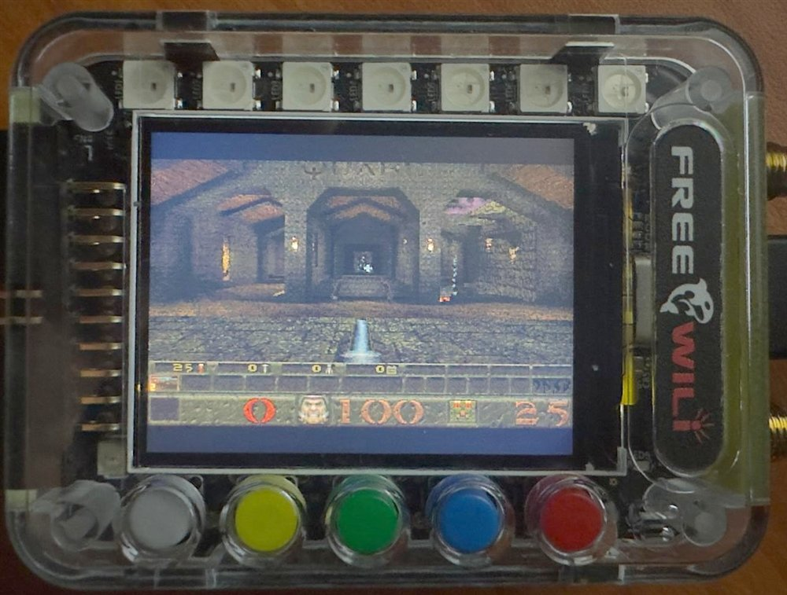 | 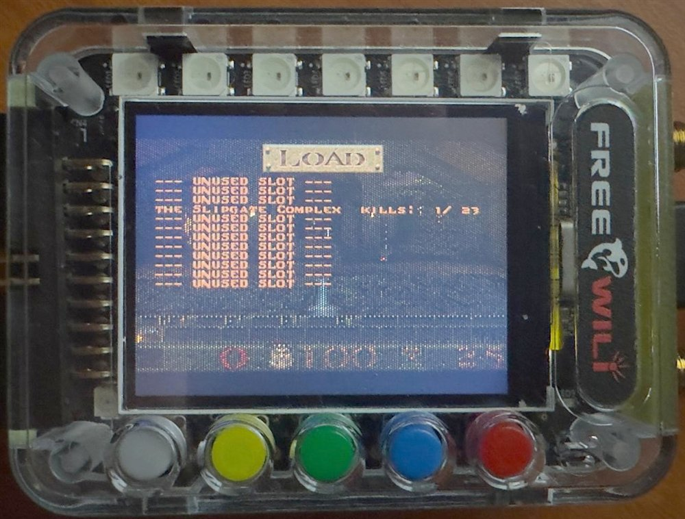 |

<sub>My own FREE-WILi OG running it. Quake and its art belong to id Software.</sub>

<p align="center">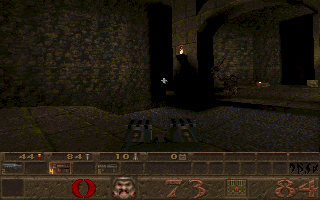</p>

| | | |
| --- | --- | --- |
| 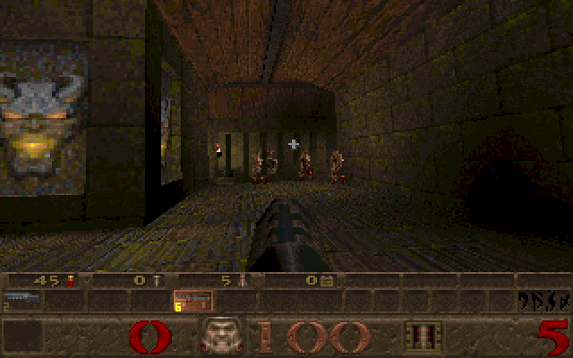 | 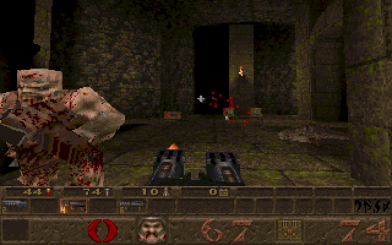 |  |
|  | 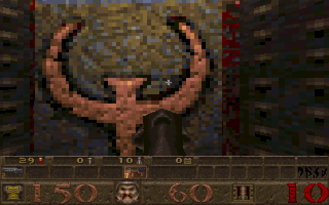 | 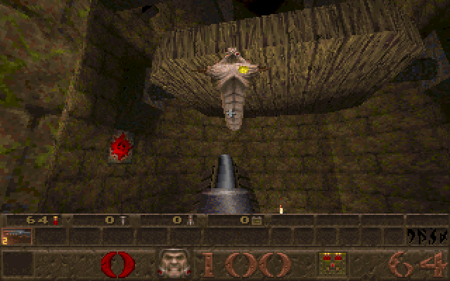 |

<sub>The clip uses the board's Fast mode settings and the screenshots use Exact mode. My photos above show it on the board. Recorded on my PC, brightened a bit.</sub>

The board is the FREE-WILi OG, a handheld with two RP2040s in it. One chip is not enough for Quake, so I split it the way Quake already splits itself for multiplayer. One chip is the **server** and runs the world. The other is the **client** and draws it.

It plays with sound, saves and loads, has its own menus for five buttons and runs episode 1. If you want the long story, read [docs/showcase.md](docs/showcase.md).

**Jump to** [Play it](#play-it) · [Controls](#controls) · [The three modes](#exact-fast-or-turbo) · [How fast](#how-fast-is-it) · [How it works](#how-it-works) · [Help out](#help-make-it-better)

## Play it

I cannot give you a ready made download. The game files belong to id Software and the firmware cannot be shared ([why](#licences)), so you build it yourself. One script does the work.

### What you need

- A FREE-WILi OG and a USB cable
- Your own copy of Quake from Steam or GOG, the original one and not the 2021 rerelease
- A Windows PC
- [Visual Studio Build Tools 2022](https://visualstudio.microsoft.com/downloads/) with "Desktop development with C++"
- The Raspberry Pi Pico extension for VS Code. Create or open any Pico project once so it downloads SDK 2.3.0 and its tools
- [Git](https://git-scm.com/), [Python 3](https://www.python.org/) and CMake 3.21 or newer

### Read this first

This **replaces the firmware on both chips**. It also runs them at **300 MHz and 1.25 V with the flash at 150 MHz**, which is over what the RP2040 is rated for and over the flash chip's 133 MHz. The game checks the flash when it starts and backs off if reads fail, but it is your board and your risk. [docs/lessons.md](docs/lessons.md) has the mistakes I already made for you.

### Build and install

1. Get the code.

   ```powershell
   git clone https://github.com/Dee-1862/quake-rp2040
   cd quake-rp2040
   ```

2. Copy `PAK0.PAK` and `PAK1.PAK` from your Quake `id1` folder into `data\id1\` as `pak0.pak` and `pak1.pak` ([help](docs/game-data.md)).

3. Build everything. The first run takes a while and nothing touches the board.

   ```powershell
   powershell -ExecutionPolicy Bypass -File tools\build.ps1
   ```

4. Plug in the board. If it never had the FreeWili display bootloader, install that once.

   ```powershell
   python -m pip install pyserial
   python third_party\wiliOGbsp\tools\fw.py bootloader
   ```

5. Install the game.

   ```powershell
   powershell -ExecutionPolicy Bypass -File tools\install_episode.ps1 -Episode 1
   ```

The script writes one chip at a time and stops if it sees two boot drives. Never copy a display app onto the board by hand ([lessons](docs/lessons.md), L4).

## Controls

| In the game | Button |
| --- | --- |
| Fire (tap for one shot, hold to keep firing) | Gray |
| Walk forward | Yellow |
| Turn left / right | Green / Blue |
| Next weapon | Red tapped |
| Previous weapon | Red + gray |
| Walk backwards | Red + yellow |
| Jump, or swim up | Red + green |
| Swim down (does nothing on dry land) | Red + blue |
| Menu | Green + blue |
| Power off | Hold red alone for 6 s |

| In menus | Button |
| --- | --- |
| Up / down | Yellow / Blue |
| Left / right | Green / Red |
| Yes | Gray |
| Back | Green + blue |

## Exact, Fast or Turbo

Pick one in **Options, Render**.

| Mode | What you get | fps on my board |
| --- | --- | --- |
| Exact | The same pixels as the original renderer | 12.8 |
| Fast (default) | Full resolution like MG24Quake, and looks almost the same as the original | 26.4 |
| Turbo | 3D view at half width and a flat gun picture, blockier | 31.6 |

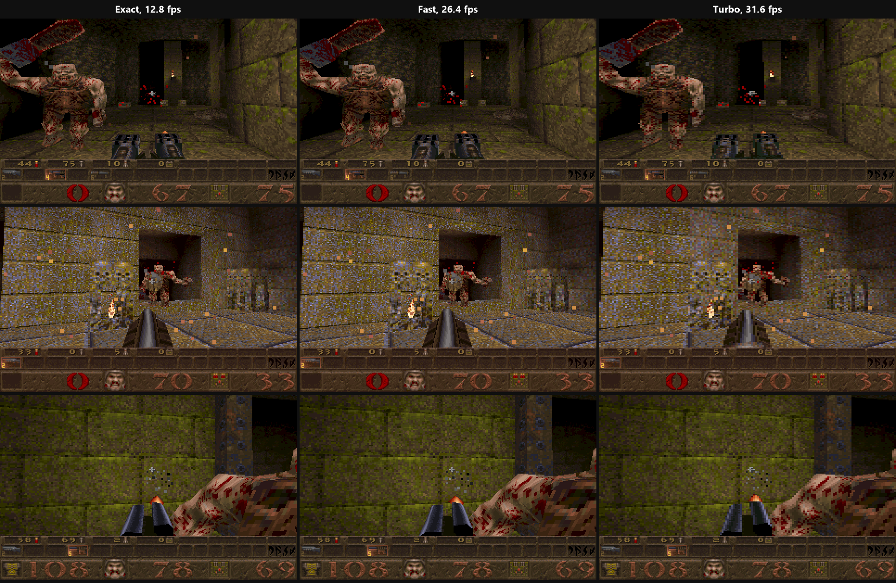

Up close, where you can see it.

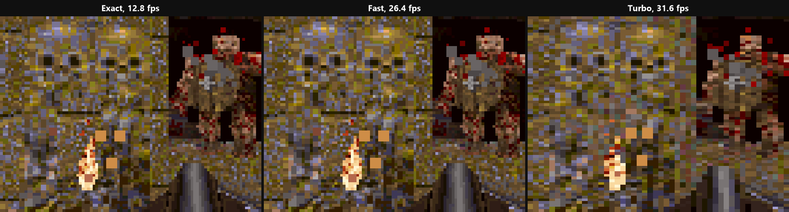

<sub>Each column is the same moment, drawn with the board's settings. The fps figures are from my board's benchmark. Recorded on my PC, brightened a bit.</sub>

## How fast is it

The goal I measure myself against is [MG24Quake](https://github.com/next-hack/MG24Quake). My numbers are from the actual board running `timedemo demo3`, and the runs are listed in [docs/fps-board.md](docs/fps-board.md).

| | fps | Time per frame |
| --- | --- | --- |
| MG24Quake, their number | 29.2 | 34.2 ms |
| **QuakeOG Fast** (default) | **26.4** | 37.9 ms |
| QuakeOG Exact, same pixels as the original renderer | 12.8 | 78.3 ms |

**I am still behind, by about 3.7 ms a frame.**

Both draw the full 320x200 screen with a 320x152 3D view and the status bar, with sound on, and count all frames over total time. The hardware is not equal. I use two chips overclocked to 300 MHz and they use one chip at a bit over 136 MHz.

Fast takes small shortcuts. On my test frames it changes 3.4% of the pixels on average and 10.5% in the worst frame. MG24Quake takes its own. Its [d_scan.c](https://github.com/next-hack/MG24Quake/blob/main/QuakeMG24/Quake/d_scan.c) corrects perspective every 32 pixels where id used 8, and the author's comment there says going back to 8 would cost about 2 fps.

There is also a **Turbo** mode at 31.6 fps. It draws the 3D view at half width with a flat gun picture, so it is a lighter job and I do not compare it with anyone.

You switch between the modes in **Options, Render**, and **Single Player, Benchmark** measures your own board.

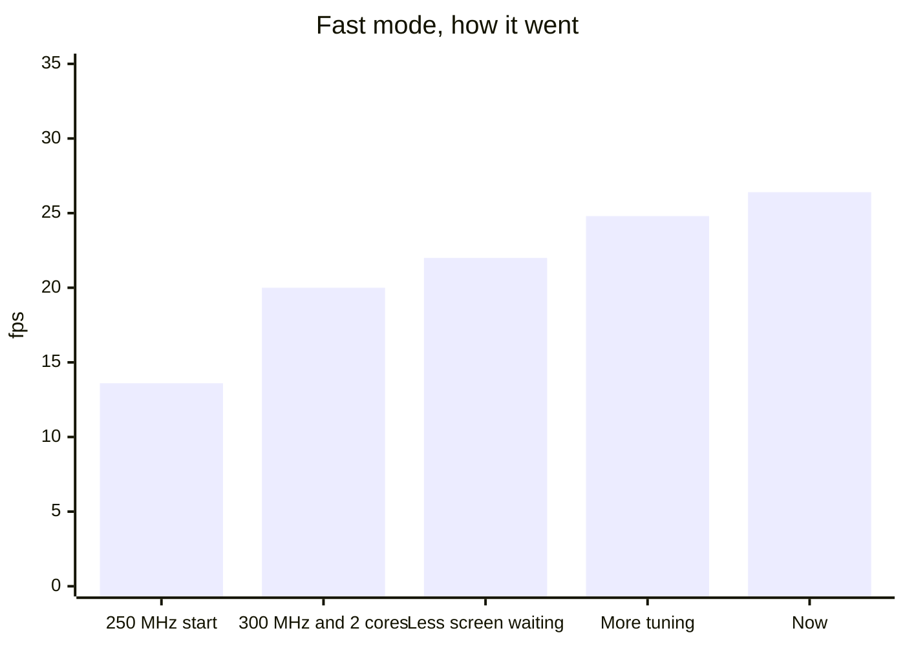

### Next to other ports

| Port | Chip | Has an FPU | Speed they report |
| --- | --- | --- | --- |
| **QuakeOG** | 2x RP2040 | no | 26.4 fps |
| [MG24Quake](https://github.com/next-hack/MG24Quake) | EFR32MG24 (Cortex-M33) | yes | 29.2 fps |
| [Quake-ESP32S3](https://github.com/recrof/Quake-ESP32S3) | ESP32-S3 with 8 MB PSRAM | yes | about 42 fps |

## How it works

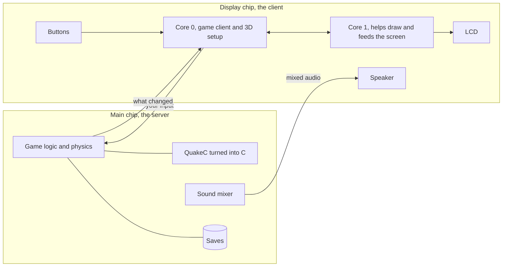

The two chips talk over UART at 12.5 Mbaud.

While one chip draws a frame, the other is already working out the next one.

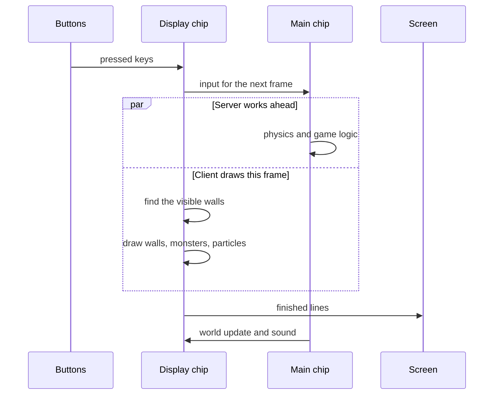

There is not enough RAM to load a level the normal way. So a tool on your PC prepares it first and the chips read it straight from flash.

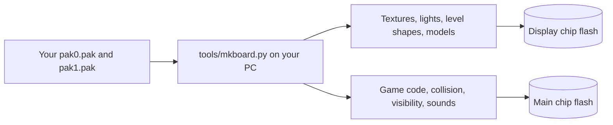

## Help make it better

You do not need the board for most of the work. The PC version runs the same game code.

```powershell
powershell -ExecutionPolicy Bypass -File tools\build.ps1    # once
build-pc-dev\Release\quakeog_pc.exe +map e1m1               # play on the PC, F12 gives the board's buttons
powershell -ExecutionPolicy Bypass -File tools\check.ps1    # before you send a change
```

Good places to start

- **Speed.** Fast mode is about 3.7 ms a frame short of MG24Quake. [docs/fps-board.md](docs/fps-board.md) has the timings and [docs/changes.md](docs/changes.md) has what was already tried, including the ideas that did not pay off
- **Testing.** Play episodes 2 and 3 on a board (`-Episode 2` on both scripts) and report what breaks
- **The depth buffer glitch** listed below
- **macOS and Linux.** The tool that makes the data images only runs on Windows today

Please follow these

- Never commit game files or anything made from them, and never share built firmware
- Exact mode must keep drawing the same pixels. Say so when a change alters Fast or Turbo
- `check.ps1` must pass. It checks the game logic, so compare screenshots for drawing changes
- Say whether you tried it on a real board

### What is where

```
engine/       id's WinQuake source, my changes sit behind QOG_ build flags
port/         what Quake needs from a system (rp2040, pc, common)
platform/     board drivers for video, input and data
apps/         the game and some smaller test apps
pc/           Windows build for testing
tools/        build, install, check, level prep, speed model
docs/         notes, start at docs/README.md
third_party/  the board support package, fetched by build.ps1
```

These folders appear after building. Git ignores all of them.

| Folder | What is in it | Safe to delete |
| --- | --- | --- |
| `build-pc-dev/` | The Windows version | Yes |
| `build-board/` | Data images made from your pak files | Yes, `build.ps1` makes them again |
| `build/` | The firmware | Yes |

## What does not work

- Only one episode fits at a time. The full game is bigger than both flash chips together.
- Only episode 1 has been run on the board. Episodes 2 and 3 build but I have not tried them on it.
- No multiplayer, no CD music, no keyboard console.
- In a few rare views the small depth buffer runs out of room. For that one frame monsters and particles can show through walls.

## Licences

- This code is GPL version 2 or later ([LICENSE](LICENSE)). `engine/` comes from id Software's GPL release of Quake ([engine/PROVENANCE.md](engine/PROVENANCE.md)).
- Anything under other terms is listed in [THIRD_PARTY_NOTICES.md](THIRD_PARTY_NOTICES.md).
- The FreeWili board support package is not included. Its licence only covers FreeWili hardware and is not open source.
- **Share source only.** Please do not share built firmware (`.uf2`, `.elf`, `.bin`). It mixes GPL code with the board package, whose hardware limit the GPL does not allow, and board images also contain Quake data.
- Quake is a trademark of its owner. This is not connected to or endorsed by id Software, Bethesda or FreeWili.
