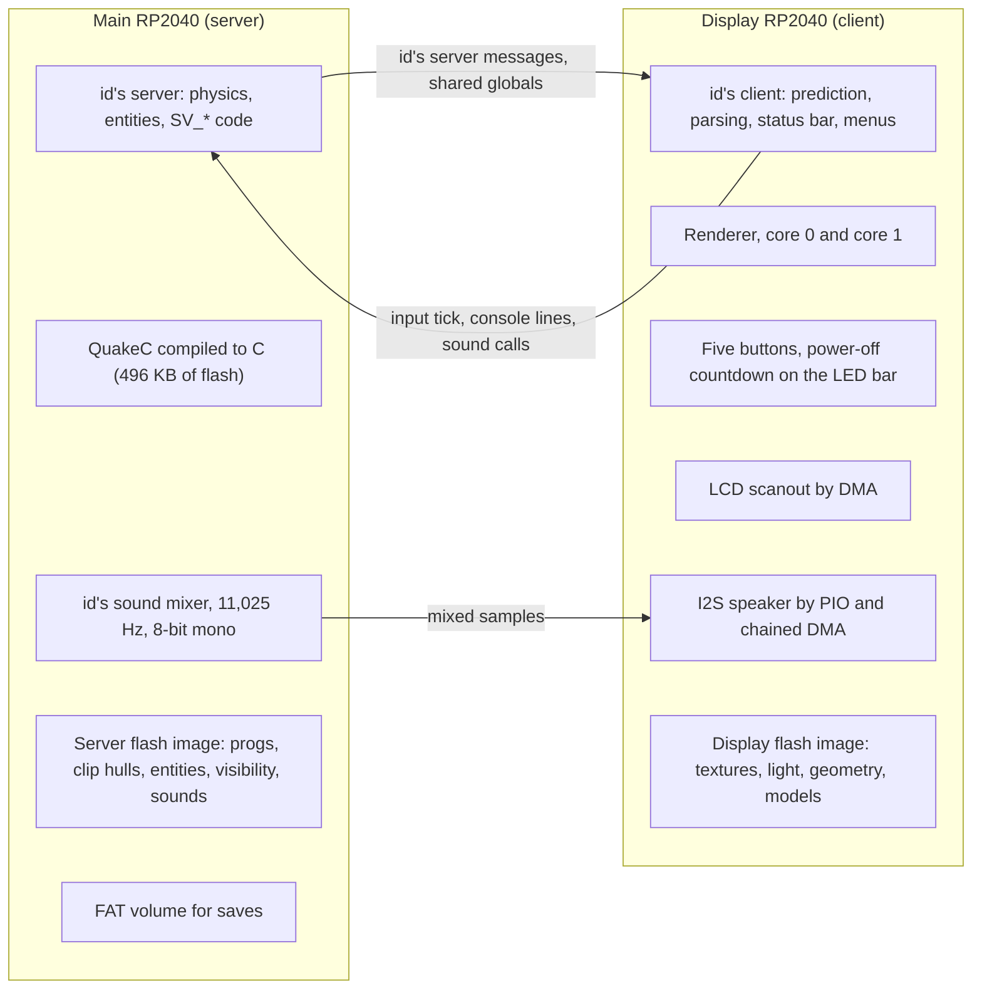

# QuakeOG, Quake on two RP2040s

QuakeOG runs id Software's WinQuake on the FREE-WILi OG, a handheld multitool built around two Raspberry Pi RP2040 microcontrollers. Neither chip has a floating point unit or external RAM. The game is split the way id split it for networked play, the main chip runs the server, the display chip runs the client and the renderer, and the board's inter-chip UART stands in for the network.

This page is the story for people who know microcontrollers but not this repo. Every number comes from the project's own measurements in [changes.md](changes.md), [lessons.md](lessons.md) and [handoff.md](handoff.md), or from the project lead's board runs. Where a number is an estimate or was measured only on the PC, it says so.

<!-- Photo or short video of the board running E1M1 goes here -->

## At a glance

| | |
| --- | --- |
| Board | FREE-WILi OG, two RP2040s (Cortex-M0+), 264 KB SRAM and 16 MB QSPI flash per chip |
| Game | id's WinQuake source, the registered game's data supplied by the user |
| Picture | 320x200 at 8 bits a pixel, a 320x152 3D view, on a 320x240 ST7789 LCD |
| Benchmark on the board, `timedemo demo3` | 12.8 fps Exact, 25.8 fps Fast, 28.5 fps Turbo (300 MHz, overclocked) |
| Exactness | Same game state hashes as one-process WinQuake. Exact render mode byte-identical to id's renderer on 121 PC test frames |
| On the board today | Episode 1, with sound and saving |

## The challenge

Quake was written in 1996 for a Pentium with 8 MB of RAM and a fast FPU. The RP2040 has none of that.

| | What Quake expects | What one RP2040 has |
| --- | --- | --- |
| CPU | Pentium, hardware floating point | Cortex-M0+, no FPU, no DSP instructions, no 64-bit multiply result |
| A float divide | a few cycles | 870 ns at 200 MHz (measured early on). Later estimates assume 55 to 75 cycles for the ROM routine, and the two have not been reconciled |
| RAM for E1M1 | about 5.9 MB in the unmodified engine (measured on the PC build, map 1.77 MB, cache 1.42 MB, surface cache 600 KB, edicts 513 KB, progs 404 KB, static 435 KB) | 264 KB |
| Static RAM alone | 435 KB in the unmodified engine (ARM compiler, measured) | 264 KB |
| Game data | the shareware `pak0.pak` is 18.7 MB, the whole registered game's display data about 38 MB | 16 MB of flash per chip, part of it taken by the apps and the bootloader |
| Reading data | RAM | QSPI flash through a 16 KB XIP cache, 538 ns per random byte, 8.5 MB/s in sequence at the stock 50 MHz (measured) |
| Display | a frame buffer in video memory | an SPI LCD. One 320x200 scanout takes 22.4 ms at 200 MHz (measured) |

The first plan was to run the whole game on the display chip alone. An honest build of that, with every buffer the game needs counted, overflowed RAM by 223,504 bytes after all the exact cuts available at the time ([changes.md](changes.md), earlier work). Shipping finished frames from the other chip is no way out either, one 320x240 8-bit frame is 76.8 KB, about 61 ms on the link. What does fit on the link is id's own network traffic, which is why the game is split along id's client and server line.

## The two-chip architecture

The link is the board's UART0 at 12.5 Mbaud with RTS/CTS hardware flow control. On top of the BSP's framed link (CRC checked) the port adds a reliable byte stream, one frame in flight, resend after a timeout, duplicates acknowledged again. On the PC a test with injected corruption and drops (39 resends, 20 CRC drops) still gave identical state hashes.

| What crosses the link | Direction | Size (PC measurement over a test run) |
| --- | --- | --- |
| The client's input tick and console lines | display to main | about 61 bytes a frame on average |
| id's server messages (entity updates, sounds to start, prints) | main to display | about 235 bytes a frame on average, 560 at most in play |
| A level load or saved game load | main to display | about 5.2 KB in one frame, about 4.2 ms at 12.5 Mbaud |
| Sound calls (`S_StartSound` and friends) | display to main | a few bytes each |
| Mixed sound samples | main to display | 11 KB/s |
| Shared globals (time, frame time, cvars, the random sequence's position) | both | with every exchange that follows a change |

Both chips build the same engine source. The server half (`QOG_SPLIT_SERVER`) has no renderer, console, sound output or menus. The client half (`QOG_SPLIT_CLIENT`) has no server. A new Quake net driver, `engine/net_link.c`, replaces id's loopback driver and keeps its rules, so id's client and server code barely change.

## Key techniques

Some clock and timing figures below were measured during earlier stages at 200 or 250 MHz.

**QuakeC compiled ahead of time.** Quake's game logic is QuakeC bytecode in `progs.dat`, run by an interpreter that keeps all of its globals in RAM. `tools/qc2c.py` translates all 2,091 functions of the user's own `progs.dat` into C at build time. Constants become C literals and most temporaries become C locals, so the RAM globals went from 45,904 to 7,280 bytes. The compiled code is 496 KB of flash on the main chip. The translation is never committed, since it is derived from id's data. E1M1 state hashes matched id's interpreter exactly.

**Baked flash images, read in place.** id's loader builds every map's planes, nodes, leafs, surfaces and texture headers in RAM at each level load, and then only reads them. `tools/mkboard.py` runs id's own loader on the PC (the `qog_bake` command) and writes what it builds into a flash image, with every pointer already resolved for the flash address the image will sit at. On the board a map load copies one `model_t` and allocates only the arrays that play writes. This cut E1M1's map hunk from 473.6 KB to 90.0 KB. Light, visibility, texture pixels and geometry are read in place from the pak through XIP, and textures shared between maps are stored once. A layout hash in the image's header makes a build refuse an image written by a build with other structure layouts (this caught real bugs, see lessons L46 on enum sizes). The server gets its own smaller image with only what physics needs.

**Lit spans without a surface cache.** id's renderer builds a lit copy of every visible surface in a surface cache of about 600 KB, then draws from it. There is no room for that. `engine/d_scanlit.c` lights each pixel from the texture and the 18x18 light grid as it draws the span. A board benchmark measured the cost, 52.5 ms for a full 320x152 view at first, against 24.0 ms for id's cached drawer, which needs the RAM we do not have. Exact rewrites of the inner loop (masks instead of modulo, constant shifts per mip level, two unrolled passes that fit the M0+'s low registers) took it from about 150 to about 65 cycles a pixel (estimate from the generated code), with the same pixels.

**Edges in the z-buffer.** id's edge sorting renderer keeps its edge table on the stack, 84,768 bytes on the ARM build. Spans are made top to bottom and each one writes z only in its own row, so the rows of the z-buffer below the current scan line are free. The edge table lives at the end of the z-buffer during edge drawing and is moved down as edges die, and the world's edge cache lives at its start. The stack frame fell to 36,184 bytes and the hunk lost 27,312 bytes on E1M1, with byte-identical pictures. Between views the same buffer holds the status bar rows, the link's receive buffer and other short-lived data, each with a stated owner and a run-time check (lessons L65).

**A one-byte depth buffer.** A 16-bit z-buffer for the 320x152 view is 97,280 bytes. Storing depth in one byte, with finer steps close to the viewer, saves 48,640 bytes. The user approved this for the board client only, because it is the one change that is not exact by construction, in rare views the edge table cannot fit beside the waiting spans and needs a fallback table on the stack that the board cannot afford. That case used to stop the game with an error (4 times in a PC fight tour of episode 1). Now, when the stack cannot hold the table, the waiting spans are drawn without z for that one view, so the world stays exact and only models and particles in those rows can show through it ([changes.md](changes.md)). Why the edges and spans meet there is still open.

**Sound mixed on the other chip.** id's mixer wants about 45 KB of tables and buffers (channels, a paint buffer, 34,816 bytes of sound names). The display chip had a few hundred bytes free. The speaker is on the display chip, but the mixer runs on main, the client's sound calls cross the link as small items, main mixes with id's own code, and the 8-bit samples come back at 11 KB/s on a 1.25 MB/s link. On the display a PIO program drives the I2S amplifier, one DMA channel feeds it from a 2 KB ring, and a second DMA channel chained to the first rewinds the ring, so playback needs no interrupt and no CPU time. On the PC the split pair mixes exactly the samples the one-process game mixes.

**Pipelining the two chips.** In plain lockstep the client sends its frame's input, waits while the server runs its frame, then draws. With pipelining the client draws frame k while the server runs frame k+1, so the server's frame and the link round trip hide behind the render. Everything that feeds the next input (view drift, key state) keeps id's order, and the PC tests give the same state hashes and frames with it on. On the PC the client's link wait fell from 8.52 s to 3.02 s over a test run.

**Core 1 and DMA.** The display chip's second core draws every second span of each lit surface while core 0 draws the others. A span writes only its own pixels and depth, so the result is the same picture. The LCD scanout runs by DMA in 16-bit SPI frames, and the next frame's input, link exchange and parsing run while it is in flight. Only drawing has to wait for the scanout to finish. Cores hand work to each other through shared memory and `__sev`/`__wfe`, not the SIO FIFO (lessons L14, a bug found on the board).

**Run-time clock and flash switch with a self-check.** The BSP runs both chips at 200 MHz and 1.15 V with flash at 50 MHz, and the display chip's bootloader must keep working at those settings because the display chip has no BOOTSEL button. So the Quake apps change the clock only at run time, after the BSP has started, 1.20 V, then 250 MHz, then every clock-derived divider re-derived (LCD SPI, link UART, I2S, I2C, backlight, the FPGA clock on main). The flash divider goes from 4 to 2 (125 MHz, within the W25Q128JV's 133 MHz rating) from code in RAM with interrupts off. Before keeping it, the routine hashes the first 128 KB of the app's image through the uncached flash alias at the old and the new divider and writes the old settings back if they differ. The bootloader is untouched. Main puts the checked divider back after every save, because the SDK's flash writes restore the boot default (lessons L56, L57).

**Exactness testing by state hashes.** Every change is checked on the PC against an untouched build. `qog_statehash` hashes the whole game state by meaning, QuakeC fields by type and strings by their text, so a change in memory layout does not change the hash but a change in behaviour does. Shared random numbers (`qog_rand`), fixed frame times and scripted runs make each run repeatable. The split pair on the PC (two processes over TCP at the UART's rate) gives the same state hashes as one-process WinQuake, and screenshots are compared byte for byte. Speed changes that are not exact, like the Fast render mode, are measured as a share of changed pixels over the same shots.

### Fast render mode

The board's default render mode trades a small picture difference for speed, in the spirit of MG24Quake's approximations but tuned to be hard to see. The Options menu switches between Exact and Fast.

| Part | What it does | Pixels changed alone (PC, 121 shots) |
| --- | --- | ---: |
| Adaptive perspective steps | a divide every 8, 16 or 32 pixels, the longest run over which 1/z changes by at most 8% | 1.49% |
| Linear light | light blended exactly at the ends of each 8-pixel run and stepped between | 1.28% |
| Integer reciprocal | 1/z from the integer divider, about 16 good bits | 0.06% |
| All three (first measurement) | | about 2.8% average, about 9% in the worst frame |
| Fast mode as it is now (measured 26 November 2026) | | 3.4% average, 10.5% in the worst frame |
| For comparison, fixed 32-pixel steps, as MG24Quake | | 14.3% average, 38% worst frame |

On the board Fast mode took E1M1 from 10.4 to 10.9 fps.

## Where the speed came from

All figures are the board's `timedemo demo3`.

| Step | Fast fps | Turbo fps |
| --- | ---: | ---: |
| 250 MHz, first full speed round | 13.6 | |
| 300 MHz, both cores drawing, faster screen link | 20.0 | 22.3 |
| Fewer waits for the screen | 22.0 | 26.0 |
| Related code placed together in flash | | 27.1 |
| Further screen wait and drawing work | 24.8 | 27.8 |
| One shared copy of the drawing code | 25.5 | 28.5 |
| Cheaper brush models | 25.8 | |

The goal was 35 fps and it was not reached. A cache measurement showed that waiting for code and data to arrive from flash is now a large part of each frame.

## Board features used

| Feature | Chip | Used for |
| --- | --- | --- |
| ST7789 320x240 LCD | display | the 320x200 picture, sent by PIO at 60 MHz and DMA |
| Five buttons (gray, yellow, green, blue, red) | display | game and menu controls, with combos |
| I2S amplifier and speaker | display | sound, by PIO and chained DMA |
| WS2812 LED bar | display | the red countdown while red is held for power off |
| Both cores | display | core 0 runs the client, core 1 draws lit surfaces, moves particles and drives the screen |
| Inter-chip UART, 12.5 Mbaud with RTS/CTS | both | the client and server link, sound calls and samples |
| 16 MB QSPI flash each, read through XIP | both | apps and the baked level images, read in place |
| FAT volume in main's flash | main | saved games |
| Watchdog | main | kicked on every link wait |
| USB CDC consoles | both | timing lines every 2 s, diagnostics |
| Accelerometer | display | used only by the platform test app, not by the game |

Not used by the game, the radios, the FPGA (its bitstream still loads at boot) and the breakout I/O.

## Other ports

A web search in November 2026 found no other Quake port on the RP2040, and none split across two microcontrollers. So this is the first we know of, not necessarily the first ever. The ports below are the useful comparison points. Several are faster, and MG24Quake in particular is both faster and holds the whole retail game.

| Port | Chip | FPU | RAM | External memory | Reported speed | Content | Source |
| --- | --- | --- | --- | --- | --- | --- | --- |
| **QuakeOG** (this) | 2x RP2040, Cortex-M0+, 300 MHz | no | 264 KB per chip | none (16 MB flash per chip) | 25.8 fps Fast, 28.5 fps Turbo (half width), demo3, measured on the board | episode 1 | this repo |
| MG24Quake (Nicola Wrachien, next-hack) | EFR32MG24, Cortex-M33 overclocked to about 136 MHz | yes | 276 KB | two 32 MB SPI flash chips plus an SD card | about 27 to 29 fps | full retail game | [github.com/next-hack/MG24Quake](https://github.com/next-hack/MG24Quake), [Habr article](https://habr.com/en/articles/848396) |
| RP2350-Quake (zenodante) | RP2350, Cortex-M33 | yes | 520 KB | none | not published, full playthrough unverified | | [github.com/zenodante/RP2350-Quake](https://github.com/zenodante/RP2350-Quake) |
| Quake-ESP32S3 (recrof) | ESP32-S3, 240 MHz | yes | | 8 MB PSRAM | 37 to 42 fps | | [github.com/recrof/Quake-ESP32S3](https://github.com/recrof/Quake-ESP32S3) |
| esp32-quake (Espressif) | ESP32-P4, dual RISC-V | yes | | 32 MB PSRAM | about 20 to 25 fps at 512x300 | | [github.com/espressif/esp32-quake](https://github.com/espressif/esp32-quake) |
| rp2040-doom (Graham Sanderson), Doom not Quake | one RP2040, 270 MHz | no | 264 KB | none | 30 to 35+ fps | full shareware DOOM1.WAD | [github.com/kilograham/rp2040-doom](https://github.com/kilograham/rp2040-doom), [design notes](https://kilograham.github.io/rp2040-doom/) |

Empty cells are figures we did not find. MG24Quake's speed comes partly from its FPU and from approximations such as a perspective divide every 32 pixels, which on our test shots changes 14% of the pixels. rp2040-doom is the closest relative in hardware and the best study of fitting an id engine into RP2040 RAM, and it influenced several techniques here. More detail on each port is in [research-open-source-quake-bases.md](research/research-open-source-quake-bases.md) and [phase1-mg24quake-notes.md](research/phase1-mg24quake-notes.md).

## Honest limits

- **Speed.** About 25.8 fps at full detail. MG24Quake reports about 29 on a chip with an FPU.
- **Not the whole game.** The display data of the whole game is about 38 MB, and both chips together have 32 MB of flash. Only one episode can be on the board at a time.
- **RAM is nearly all used.** The display chip has a few hundred bytes spare.
- **The one-byte depth buffer's fallback** draws one view without z in rare views, a one frame glitch (see above).
- Sound and saving work on the board.
- **Overclock.** 300 MHz at 1.25 V with flash at 150 MHz is above the RP2040's and the flash chip's ratings. The game checks flash reads and falls back, the core clock is not checked.
- **Fast and Turbo are not exact.** Fast is the board default. Exact mode is one menu switch away.
- No multiplayer, no CD music, no console keyboard.
- **Publishing.** The engine is GPL and the board's BSP is under the FreeWili Hardware License. Whether they can be combined is an open question for FREE-WILi, so only the source is published, never built firmware. The game data is never in the repo.

## What is next

1. The busiest small routines in RAM.
2. Try the episode 2 and 3 images on the board.
3. Close the one-byte depth buffer's fallback case.
